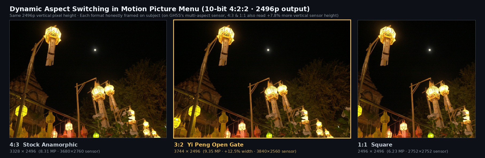

# Yi Peng (`yipeng-gh5s`)

Open-source firmware mod for the **Panasonic Lumix DC-GH5S (V2.5)**: dynamic **3:2 Open Gate (`3744×2496`)**, **1:1 Square (`2496×2496`)**, native **24-bit LPCM** without the XLR1 adapter, **SD bitrate profiles** (incl. V30-compatible **`200M ALL-I`**), **Video Guide Lines** in Open Gate, and the **in-camera playback green-stripe fix**.


*Unedited `3744×2496` `24p` 10-bit 4:2:2 `V-Log L` frame grab (V-Log L → Rec.709 preview) from a 58 GB / 51.8 min real-world night shoot (113 consecutive clips, 0 decode errors).*

> **Legal Notice:** Independent open-source project, not affiliated with Panasonic. LUMIX and GH5S are trademarks of Panasonic Holdings Corporation. Contains **zero Panasonic firmware binaries, zero decrypted partitions, and zero keys** — supply your own official `GH5S_V25.bin`.

---

## Features

### 1. Dynamic Open Gate `3:2` ↔ `4:3` ↔ `1:1` (Video Menu Page 1)
Relocates the 34-item Motion Picture menu (`0x081831c8 → 0x06AA1800` inside `program`, zero `postboot1` edits) to add Panasonic's native multilingual **`Aspect Ratio`** selector right under `Rec Quality`:

| Motion Picture → Aspect Ratio | 10-bit 4K/A Video (`23.98p / 24p / 25p`) | Sensor Readout | LiveView / OSD / HDMI | Playback / Thumb |
|---|---|---|---|---|
| **`4:3`** | **`3328 × 2496`** *(stock)* | `3680 × 2760` | `4:3` | `1440×1080` / `320×240` |
| **`3:2`** *(or `16:9`)* | **`3744 × 2496`** *(Open Gate 3:2)* | `3840 × 2560` | `3:2` | `1620×1080` / `352×240` |
| **`1:1`** *(`--enable-1x1`)* | **`2496 × 2496`** *(Square 1:1)* | `2752 × 2752` | `1:1` | `1080×1080` / `240×240` |



* **Why `3744×2496` (not `3840×2560` or `4096×2760`)?**
  1. **H.264 Level 5.1 ceiling (`36,864` MB/frame):** `3744×2496` = `36,504` MB (**99.0%**); `3792×2528` (`37,446`) and `3840×2560` (`38,400`) exceed L5.1.
  2. **Fixed `84.00 MiB` `GaiaWork` DRAM partition:** `StartEnc` MV + Ref pools at `3744×2496` use **`82.28 / 84.00 MiB`** (**98.0%**, `1.72 MiB` spare).
  3. **Multi-aspect MFT image circle (`Ø 21.6 mm`):** `4096×2760` (`Ø 22.8 mm`) vignettes in all four corners; switching `3:2` ↔ `4:3` gives full native `3:2` width (`3840×2560`) or full native `4:3` height (`3680×2760`) on demand.
* **Safety isolation:** `29.97p` (`> L5.1`, unless `--allow-2997p`) and `50p/60p 8-bit` remain at stock `3328×2496`.
* **Green-stripe playback fix included:** Resizes `StartDec` MV (`0x110000 → 0x120000`) and `DPB[5]` (`0x07391f2c`, `37.22 MiB` headroom); plays back `4:3`, `3:2`, and `1:1` clips seamlessly on-camera.

### 2. SD Card Bitrate Profiles (`patches/bitrates.py`)
Use `--sd-profile` or override `--longg-bitrate` (`100–300` Mbps) / `--alli-bitrate` (`200–600` Mbps) (add `--scale-all-4k` to include C4K & UHD 4K):

| `--sd-profile` | SD Card | 10-bit LongGOP | 10-bit ALL-Intra | Notes |
|---|---|---|---|---|
| **`v30-eco`** | Light UHS-I V30 | **`100 Mbps`** | **`200 Mbps`** | Smallest files |
| **`v30`** | Standard UHS-I V30 | **`150 Mbps`** *(stock)* | **`200 Mbps`** | **Verified on V30 SD** (`209.7 Mbps`, 0 errors, no speed warning) |
| **`v60`** *(default)* | UHS-II V60 | **`200 Mbps`** | **`400 Mbps`** *(stock)* | **Verified** (`31s` / `68.5s` clips) |
| **`v90`** *(exp.)* | UHS-II V90 | **`250 Mbps`** | **`500 Mbps`** | Test in volatile RAM first |

### 3. Native `16-bit ↔ 24-bit` LPCM Audio (`--lpcm24-menu`)
Unlocks **`XLR Mic Adaptor Setting`** without spoofing DMW-XLR1 hardware detection (all internal/3.5 mm mic menus stay active):
* **`OFF` / `48kHz/16bit`**: 100% stock 16-bit LPCM (preserves 4ch Wind Cut ZNC).
* **`48kHz/24bit` (MOV)**: True 24-bit / 48 kHz LPCM (`pcm_s24be`) on internal & 3.5 mm mics via conditional 2ch DMA + TDM routing.
* **`96kHz/24bit`**: Greyed out without a physical DMW-XLR1; automatically re-enabled if one is attached.

### 4. Video Guide Line Unlock (`--gh7-extras`)
Removes the stock `16:9`-only check (`0x06357248`) so Panasonic's built-in **Video Guide Line** (`2.39:1` / `2.35:1`, etc.) works in `3:2`, `4:3`, and `1:1`.

---

## Quick Start

**Prerequisites:** Python 3.10+ (stdlib only for offline build/verify). Optional: `pyusb` (`pip install -r requirements.txt`) for USB Service Mode RAM testing, `llvm-mc` for disassembly tests.

```bash
# 1. Standalone ARM32/Thumb-2 assembly, 8B stack alignment & CPB bounds test (needs no firmware files)
python3 tests/test_offline.py --caves-only

# 2. Full verification against decrypted stock V2.5 partitions (incl. mid-instruction branch-collision audit)
export GH5S_FW_DIR=/path/to/GH5S_V25_decrypted
python3 tests/test_offline.py

# 3. Test safely in 100% volatile RAM first (USB Service Mode 04da:2370; remove battery 5s to revert)
python3 gh5s_patcher.py --all --sd-profile v30 --ram-apply --confirm-ram-only

# 4. Build roundtrip-verified GH5S_V26.bin + stock rollback GH5S_V27.bin
python3 gh5s_patcher.py --all --sd-profile v30 \
  --orig-fw /path/to/GH5S_V25.bin \
  --key-file /path/to/gh5s_aes5_key.bin \
  --aes5-lib /path/to/libpana_aes5.so \
  --build-upd builds/GH5S_V26.bin \
  --rollback-out builds/GH5S_V27.bin
```

### Flashing & Rollback
* **45/47 partitions** stay bit-for-bit stock (`loader1/2/3`, Linux/SD updater, and `postboot1` are never modified).
* Because `0x0608c6c8` resets `0x06038018..0x0603801f` to `0` on every boot, **Panasonic's RSA signature check stays ON across reboots**.
  * **Flash `GH5S_V26.bin` (or `GH5S_V27.bin`):** copy `.bin` to SD root, set `0x0603801a = 1` in volatile RAM via USB Service Mode, unplug USB **without powering off**, and press Playback.
  * **Factory rollback (recommended):** copy official signed `GH5S_V25.bin` to SD root, set only `0x0603801c = 1` (same-version update, RSA stays ON) in volatile RAM, unplug USB without powering off, and press Playback.

---

## Hardware Qualification Status

| Feature / Profile | Offline | Hardware Verified (`ffprobe` + On-Camera) |
|---|---|---|
| Dynamic `4:3 ↔ 3:2 ↔ 1:1` + Video Menu `Aspect Ratio` + Dynamic SPS + Green-Stripe Playback Fix | Yes | **Verified** — 113 consecutive real-world clips (`51.8 min`, `58 GB`, max take `4m26s` / `5.06 GB`), `0` decode errors, native `V-LogL/V-Gamut` XML metadata & mixed playback |
| `v30` Profile (`150M LongGOP / 200M ALL-I` in `3744×2496`) | Yes | **Verified** — `11.50s` @ `209.7 Mbps` ALL-I (`12/12K`), `0` errors on UHS-I V30 SD |
| `v60` Profile (`200M LongGOP / 400M ALL-I`) | Yes | **Verified** — `31s` & `68.5s` continuous clips |
| `16-bit ↔ 24-bit` LPCM Toggle (`lpcm24_menu`) | Yes | **Verified** — `pcm_s24be` (`90.6%` non-zero LSBs) + clean 16-bit toggle |
| Video Guide Line Unlock (`gh7_extras`) | Yes | **Verified** in `3:2` Open Gate |
| `v30-eco`, `v90`, custom bitrates, `--scale-all-4k`, `23.98p`/`25p` | Yes | Offline verified — test in volatile RAM first |

---

## Disclaimer
Always test in **volatile RAM** first and use a **fully charged battery** before flashing NAND. Provided AS-IS under the [MIT License](LICENSE); use at your own risk.
